<h1 align="center">MacShell for Linux Mint Cinnamon</h1>

<p align="center">
  A macOS&nbsp;Tahoe–style menu bar, Dock, widgets, Spotlight, Control Center and <b>Finder</b><br>
  running on top of your real Linux&nbsp;Mint Cinnamon desktop.
</p>

<p align="center">
  
</p>
<p align="center"><sub>Real screenshot of the released build on Linux Mint 22.3 (Cinnamon 6.6, X11), 1920×1080.</sub></p>

---

## Install

```bash
curl -fsSL https://raw.githubusercontent.com/jacobpowaza/MacShell-LinuxMint-Cinnamon/main/install.sh | bash
```

Prefer to read it first? Download, review, then run:

```bash
curl -fsSLO https://raw.githubusercontent.com/jacobpowaza/MacShell-LinuxMint-Cinnamon/main/install.sh
less install.sh
bash install.sh            # add --dry-run to see what it would do without changing anything
```

The installer lives entirely in your home folder. It uses `sudo` for one thing only — `apt-get install` of a few missing packages, after you confirm. It backs up every setting and file it touches, so [`uninstall.sh`](#uninstall) can put your desktop back.
First run downloads about 1.5 GB (3 GB on disk) for the Quickshell runtime; later runs are quick.

## What you get

| | |
|---|---|
| **Menu bar + Dock** — Liquid Glass blur, magnifying Dock, per-app window grouping, a Trash that works. | **Finder** — a real file manager: four views, tags, Quick Look, drag & drop. |
| **Spotlight** — app, window, clipboard and emoji search (`Super+Alt+Space`). | **Control Center, Settings, widgets, wallpaper picker.** |

### Finder

A multi-window file manager that becomes your default folder handler. Icon, List, Column and Gallery views; Shared / Recents / Favorites sidebar; persistent colour Tags; Quick Look; rubber-band selection; context menus; copy / cut / paste / rename / new folder; move to Trash and *Put Back*; dragging files between Finder windows and into other GTK apps (Control = copy); drop a folder on Favorites to pin it.

<p align="center">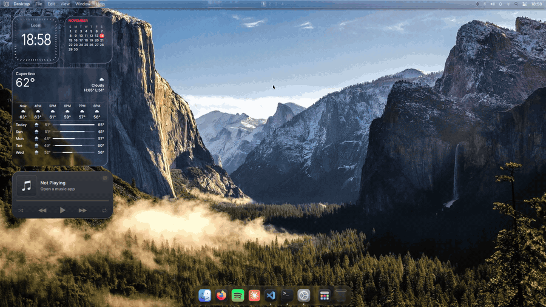</p>

| Gallery view | Column view |
|---|---|
| 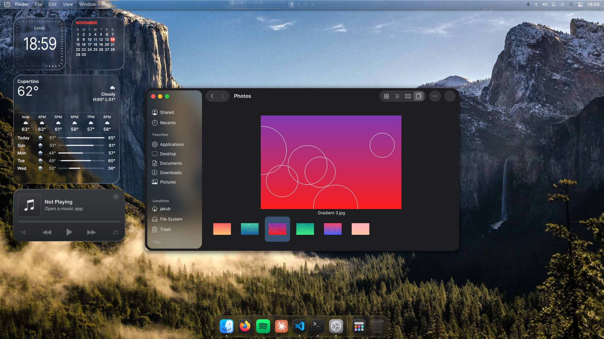 | 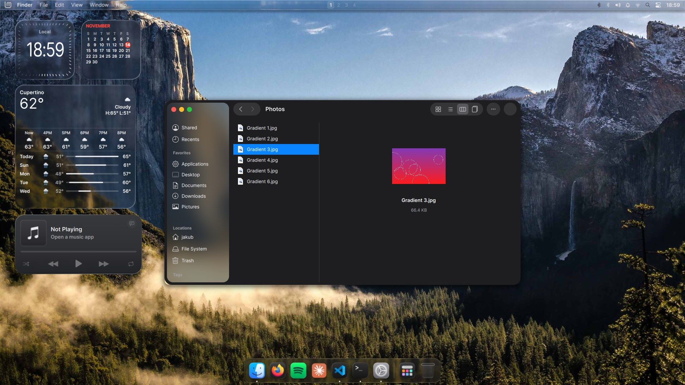 |
| **Icon view** | **List view** |
| 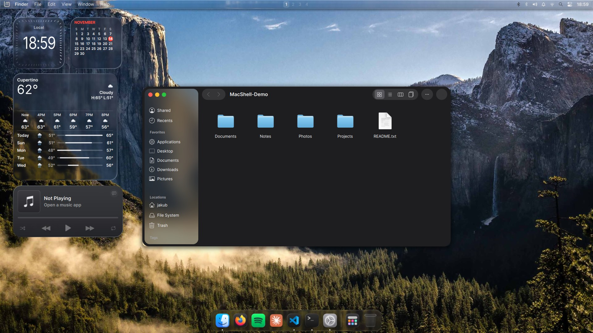 | 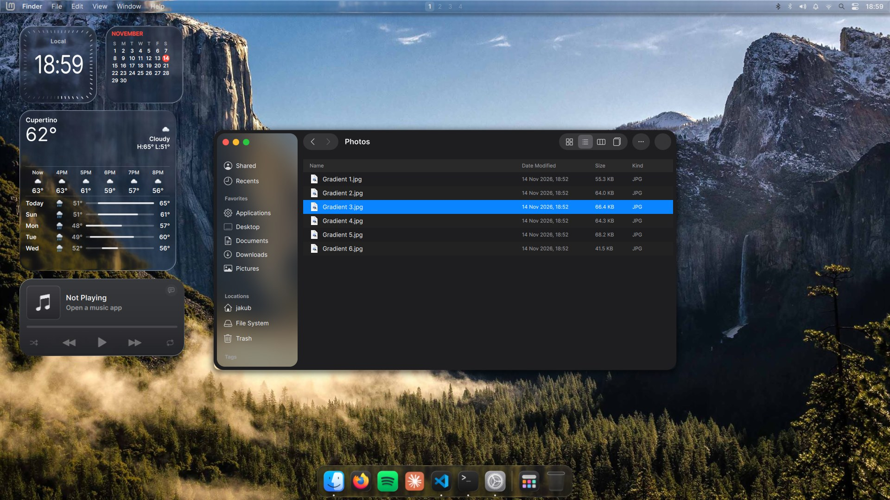 |

### Dock

Click to launch, focus or minimise; apps with several windows are grouped and can be cycled; right-click for window list, pin, new window and close. The Dock reserves space under maximised windows and hides for fullscreen apps.

<p align="center">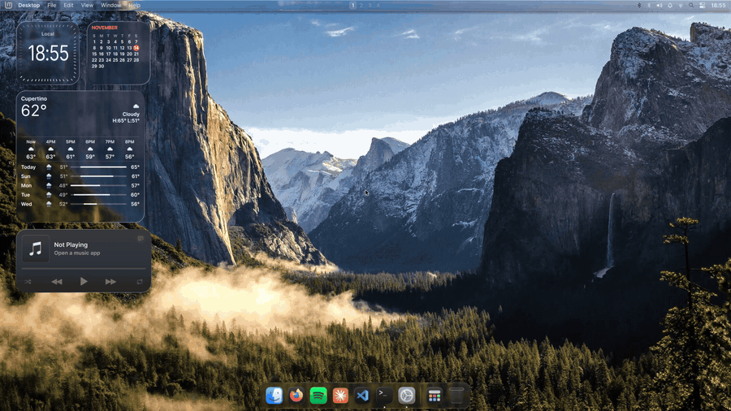</p>

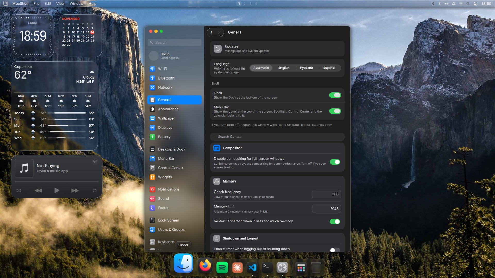

### Spotlight, Control Center, Settings

Spotlight finds applications and open windows, and opens the clipboard history / emoji picker. Control Center has Wi-Fi, Bluetooth, Focus, screen recording, Game Mode, display and sound sliders. **Settings** is a single macOS-style window that edits the *real* Cinnamon settings (two-way synced), plus a software-updates page for APT, Flatpak and Snap.

<p align="center">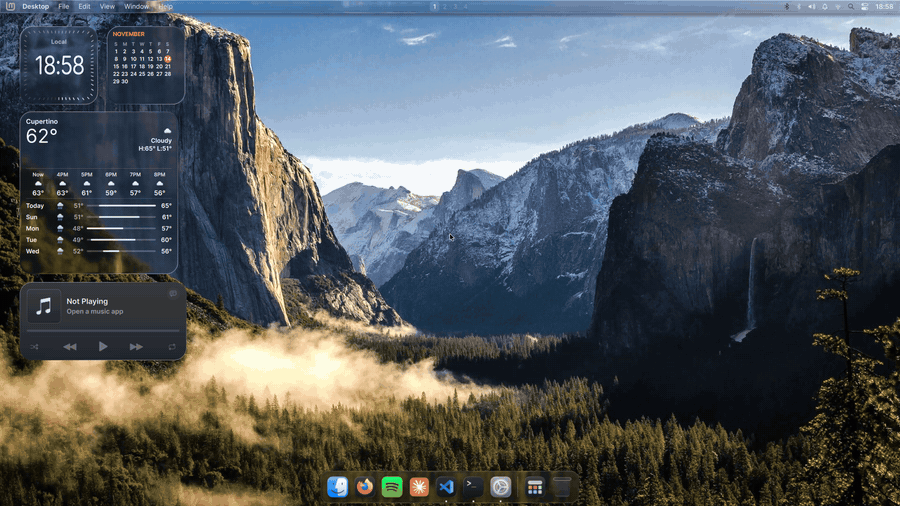</p>

| Control Center | Settings |
|---|---|
| 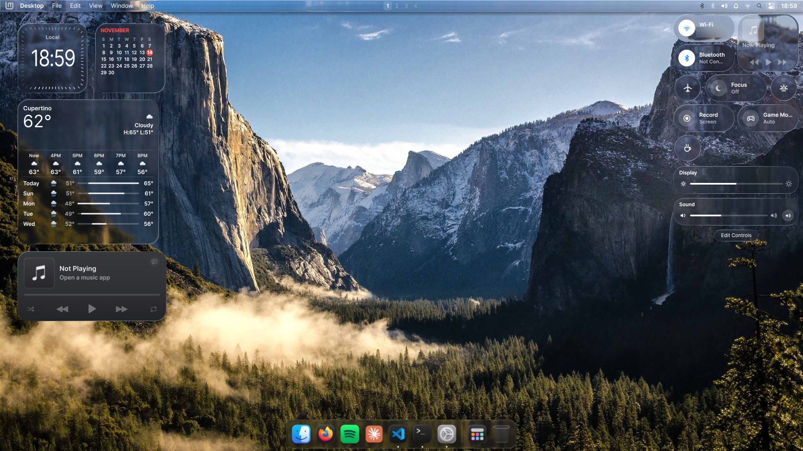 | 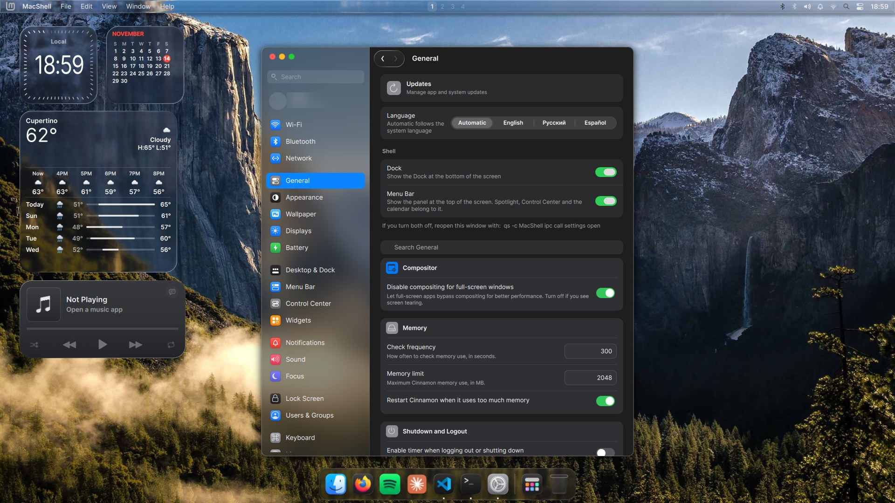 |

### Widgets and wallpapers

Clock (any time zone), calendar, weather (Open-Meteo, any city), and a now-playing card for any MPRIS player. Edit mode lets you add, drag and resize widgets. The wallpaper picker browses the macOS wallpaper catalogue and downloads an image only when you pick it.

<p align="center"></p>

| Widget gallery | Wallpapers |
|---|---|
| 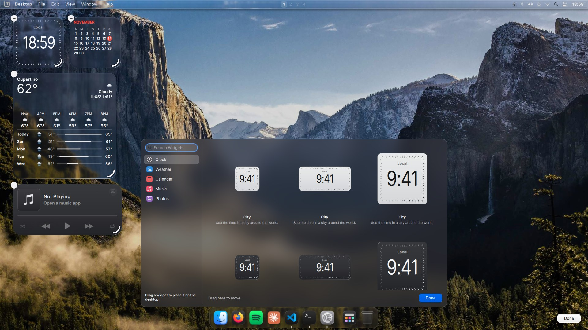 | 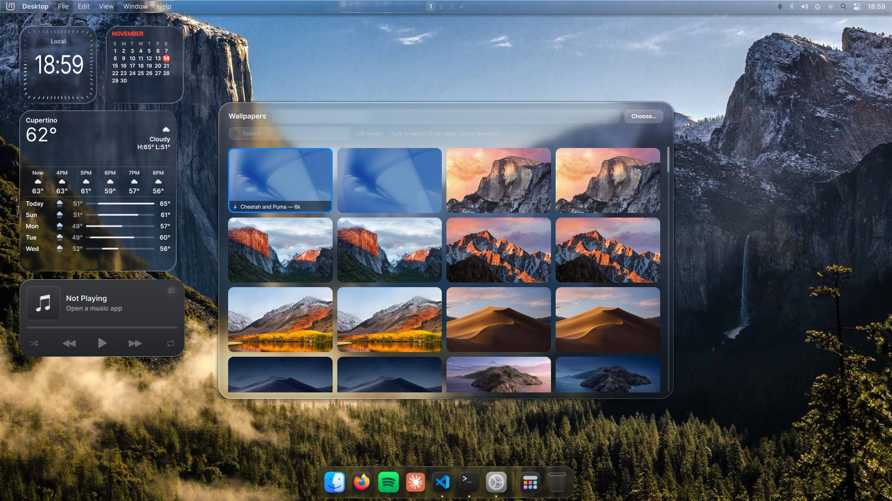 |

### Windows

Normal GTK3/GTK4 apps get macOS-style red/yellow/green window buttons, rounded corners and shadows (via the *Rounded Corners* Cinnamon extension). Fullscreen and maximised windows stay square.

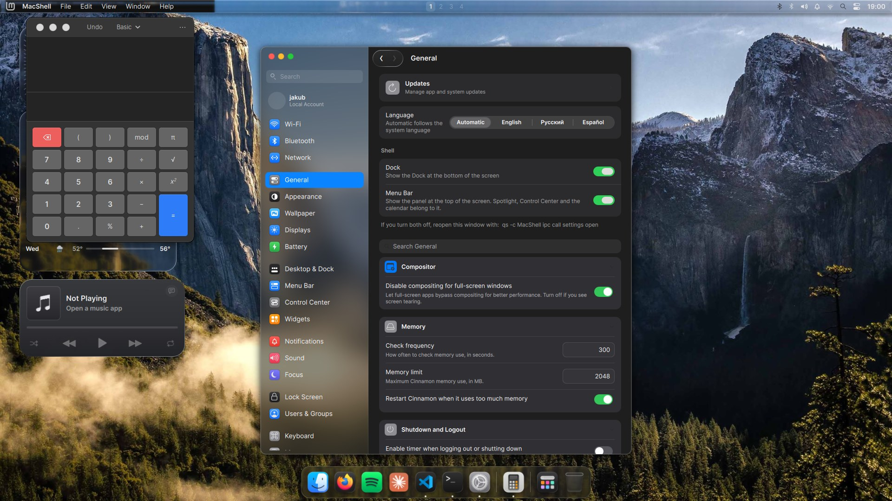

## What's new compared with the original MacShell

[MacShell](https://github.com/0-ss/MacShell) by 0-ss is a Hyprland/Wayland shell. This repository ports it to **Linux Mint Cinnamon on X11** and adds:

- **The Cinnamon/X11 port itself** — a Python adapter replaces Hyprland's APIs (windows, workspaces, monitors, wallpaper, clipboard, screenshots, recording) using Xlib, `wmctrl`, GIO and D-Bus. The original widgets, fonts and Liquid Glass shaders are kept.
- **Finder** (new) — multi-window file manager described above.
- **Native Settings** that edit Cinnamon's real settings, a **software-update manager** (APT / Flatpak / Snap), and a **Trash** service.
- **Window management for ordinary apps** — traffic-light buttons, rounded corners, grouped Dock windows, a stable Dock context menu.
- **MacLock on Cinnamon's real lock screen** — the Liquid Glass lock visuals are hosted inside `cinnamon-screensaver`, so password entry and PAM stay with Cinnamon.
- **Widget gallery / editor**, per-widget settings, weather glyphs, lazily-downloaded wallpaper catalogue.
- **A one-command installer and uninstaller** with backup and restore (this release).

The untouched Hyprland sources are kept in [`upstream-hyprland/`](upstream-hyprland/).

## Requirements

Tested on **Linux Mint 22.3 "Zena", Cinnamon 6.6.9, X11, x86-64**, NVIDIA proprietary driver. The installer refuses to run elsewhere unless you pass `--force`.

- Linux Mint 22.x (Ubuntu 24.04 base) with Cinnamon 6 **in an X11 session** (Wayland is not supported)
- ~6 GB free disk space and an internet connection for the first install
- apt packages (installed for you, with confirmation): `python3-xlib python3-gi python3-gi-cairo python3-pil python3-cairo gir1.2-gtk-3.0 wmctrl x11-xserver-utils xclip jq curl git fontconfig dconf-cli xdg-utils`
- Optional: `ffmpeg` (screen recording), `brightnessctl`

Quickshell 0.3.2 and Mesa are fetched from `cache.nixos.org` into `~/.local/share/macshell-cinnamon/runtime` with [nix-portable](https://github.com/DavHau/nix-portable); nothing is installed system-wide.

## Fonts and icons

Apple's SF fonts and SF Symbols are proprietary and are **not** included. By default MacShell uses the open **Open Runde** font and freedesktop symbolic icons (the screenshots above show exactly that). If you own SF Pro locally, install it and the installer will use it; to use SF Symbols, export the SVGs to `~/.local/share/macshell-cinnamon/symbols/`.

## Uninstall

```bash
bash ~/.local/share/macshell-cinnamon/uninstall.sh          # or: macshell-cinnamon-uninstall
bash ~/.local/share/macshell-cinnamon/uninstall.sh --keep-runtime   # keep the 3 GB runtime for a later reinstall
```

It stops MacShell, restores every gsettings key, file and theme that was changed (from the backup taken on the first install — re-running the installer never overwrites it), gives Cinnamon its notification service back, and deletes MacShell's files. Your own files are never touched.

## Troubleshooting

| Problem | What to do |
|---|---|
| *"needs an X11 session"* | Log out, click the session icon on the login screen and choose **Cinnamon** (not "Cinnamon on Wayland"). |
| *Quickshell download fails* / interrupted | Re-run the installer; it resumes. Check you can reach `cache.nixos.org` and `github.com`. |
| No menu bar after install | `journalctl --user -u macshell-source.service -u macshell-native.service -n 50`. The Cinnamon panel is only hidden after MacShell starts successfully; `--keep-panel` never hides it. Restore anything with `uninstall.sh`. |
| Black / glitchy glass on NVIDIA after a driver update | The runtime borrows the host's NVIDIA userspace libraries; reboot so kernel module and libraries match, then `macshell-cinnamon restart`. |
| Text looks different from the screenshots | You have SF fonts installed, or `~/.config/fontconfig/conf.d/60-macshell-fallback.conf` was removed. Re-run the installer. |
| Another file manager still opens | Run `xdg-mime default org.macshell.Finder.desktop inode/directory`; an app that talks to `org.freedesktop.FileManager1` may use whichever owner registered first. |
| `~/.local/bin` not on PATH | Log out and in (Mint adds it automatically once the folder exists). |

Commands: `macshell-cinnamon {start|stop|restart|control|spotlight|settings|finder [PATH]|widgets}`.

## Known limitations

Be aware before installing:

- **Verification scope.** Developed and tested on one machine (Mint 22.3, NVIDIA). The Mesa (Intel/AMD) path, other Mint versions, multi-monitor / mixed scaling and physical suspend/resume of the lock screen are **untested**. A clean-machine install has not been performed.
- Glass effects refract the wallpaper, not live windows. Animated (video) wallpaper glass is disabled, since Qt Multimedia isn't in the small runtime.
- Cinnamon still owns Alt+Tab; third-party app menus are not exported into the top bar; window buttons depend on the app's toolkit (custom titlebars may differ).
- Screen locking reuses Cinnamon's authentication; this is a visual replacement, not a separately audited security component.
- The experimental GTK dialog adapter is opt-in (`--native-dialogs`, needs `gcc` and `libgtk-3-dev`).

More detail on design decisions and test evidence: [`docs/design/`](docs/design/).

## Credits and licences

- **[MacShell](https://github.com/0-ss/MacShell)** by **0-ss** — original Hyprland shell, widgets, fonts and Liquid Glass shaders (MIT, see [`LICENSE`](LICENSE) and [`cinnamon/LICENSE.upstream`](cinnamon/LICENSE.upstream)).
- **Linux Mint Cinnamon port, Finder, Settings/updates, window management, lock integration, installer** — [jacobpowaza](https://github.com/jacobpowaza).
- GTK/Cinnamon theme base: [WhiteSur](https://github.com/vinceliuice/WhiteSur-gtk-theme) by vinceliuice (GPL-3.0).
- Icons: [MacOS-Like](https://github.com/Scrimas/MacOS-Like) / MacTahoe (GPL-3.0), downloaded at install time.
- [Rounded Corners](https://github.com/linuxmint/cinnamon-spices-extensions) extension by klangman (GPL-3.0).
- Wallpapers are fetched on demand from [LAYTAT/macOS-Wallpapers](https://github.com/LAYTAT/macOS-Wallpapers); they are Apple's artwork and not redistributed here.
- Open Runde font (SIL OFL) bundled by upstream MacShell; [nix-portable](https://github.com/DavHau/nix-portable), [Quickshell](https://quickshell.org) and [Open-Meteo](https://open-meteo.com).

macOS and SF are trademarks of Apple Inc. This is an independent project, not affiliated with Apple.
